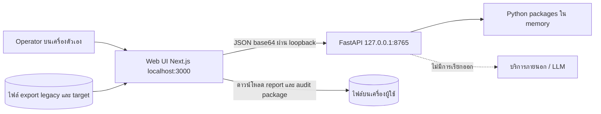
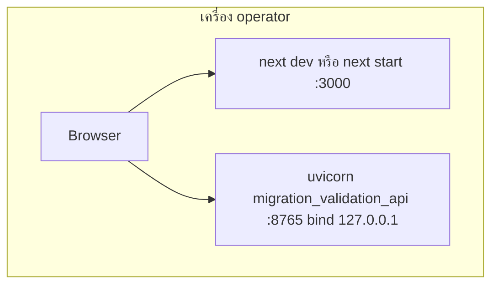

# Migration Validation Workbench — System Architecture

## 1. Context diagram

ไม่มี database, ไม่มี auth และไม่มี outbound call ใด ๆ ตามโค้ดและ README

## 2. Components/containers

| Boundary | Path | Python package | หน้าที่ |
|---|---|---|---|
| Web | `apps/web` | — | Next.js 15 App Router + React 19 หน้าเดียว (`app/page.tsx`): upload, mapping, run, evidence, review, download |
| API | `apps/api` | `migration_validation_api` | FastAPI + Pydantic: `/api/health`, `/api/normalization-profiles`, `/api/inspect`, `/api/reconcile`, `/fixtures/*`; CLI `migration-workbench` |
| File input | `connectors/file-input` | `migration_input` | อ่าน CSV/TSV/XLSX (stdlib zip+XML)/Parquet (PyArrow optional) → `CanonicalDataset`, SHA-256, configuration fingerprint, จำกัดขนาด |
| Reconciliation core | `packages/reconciliation-core` | `reconciliation_core` | `normalize_header`, `suggest_mapping`, `reconcile`, `generate_sql`, normalization profiles, fuzzy scoring |
| Data engine | `packages/data-engine` | `migration_data_engine` | profiling ที่ไม่เปิดเผยค่า raw ด้วย DuckDB และ fallback เป็น Python |
| Privacy | `packages/privacy` | `migration_privacy` | `redact_result` แบบ deep-copy; ค่าเริ่มต้นจับ field ที่มี `address`, `email`, `name`, `passport`, `phone`, `mobile`, `tax` |
| Audit | `packages/audit` | `migration_audit` | `build_audit_package` schema `mvw.audit.v1`, `rule_version` `reconciliation-core@0.2.0`, `raw_values_included` เป็น false |
| Contracts | `packages/contracts` | — | `reconciliation-result.schema.json` (JSON Schema 2020-12) |
| Evals | `evals/tests` | — | regression tests |
| Deploy | `deploy/` | — | README ระบุสิ่งที่ต้องมีก่อน production เท่านั้น |

## 3. Tech stack

| ชั้น | เทคโนโลยี |
|---|---|
| Python | ≥ 3.10 (CI ใช้ 3.11), FastAPI ≥ 0.115, Uvicorn ≥ 0.30, DuckDB ≥ 1.0, PyArrow (extra `parquet`) |
| Web | Next.js ^15.5, React ^19.1, TypeScript ^5.6 (ไม่มี UI library) |
| Build | setuptools; wheel เดียวรวม 6 package (`[tool.setuptools.package-dir]`) |
| QA | pytest, httpx, ruff (`--select F`) |

## 4. Data stores

ไม่มี data store ถาวร

| ข้อมูล | ที่อยู่ | อายุ |
|---|---|---|
| ไฟล์ input | body ของ request (base64) และ memory ของ API | ต่อ request |
| ผล reconcile, review status | state ของ React ใน browser | จนปิดหน้า |
| sample data | `apps/api/src/migration_validation_api/sample_data/*.csv` (สังเคราะห์) | ถาวรใน package |
| report/audit/SQL | ไฟล์ที่ผู้ใช้ดาวน์โหลด หรือ clipboard | ตามผู้ใช้ |

## 5. Integrations

ไม่มี integration ภายนอกใน V1; connector ฐานข้อมูลและ AI-assisted mapping อยู่หลัง decision gate (brief §7) โดยต้องผ่าน schema validation และ human approval

## 6. Deployment topology

- CLI ปฏิเสธ host ที่ไม่ใช่ loopback เว้นแต่ใส่ `--allow-remote`
- CORS อนุญาตเฉพาะ `http://localhost:3000`, `http://127.0.0.1:3000` หรือค่าใน `MVW_ALLOWED_ORIGINS`

## 7. ADR สำคัญ

| ID | การตัดสินใจ | เหตุผล | หลักฐาน |
|---|---|---|---|
| ADR-01 | Local-first, ประมวลผลใน memory, ไม่เรียก LLM | ข้อมูลลูกค้าเป็นความลับ | README, brief §3 |
| ADR-02 | Deterministic code เป็นผู้ตัดสินผล; AI ในอนาคตช่วย mapping/explanation เท่านั้น | ตรวจซ้ำได้ | brief §7 |
| ADR-03 | Fuzzy match เป็นคำแนะนำ ไม่ auto-approve | ลด false match | `test_fuzzy_candidate_is_advisory_and_never_auto_approved` |
| ADR-04 | Monorepo แยก boundary เป็น package เพื่อแยก repo ได้ภายหลัง | ownership ชัด | README "Technology boundaries" |
| ADR-05 | Bind loopback เป็นค่าเริ่มต้นเพราะไม่มี auth | ป้องกันข้อมูลรั่วผ่าน network | commit 2026-10-01, `cli.py` |
| ADR-06 | Column ใน SQL เป็น delimited identifier, table name strict | รองรับ header ไทย/ช่องว่างอย่างปลอดภัย | `docs/UPGRADE-PLAN.md` |

## การอนุมัติ

| บทบาท | สถานะ | วันที่ | ลงนาม |
|---|---|---|---|
| Solution Architect (Book Dev) | รอพิจารณา | — | ________ |

## แหล่งข้อมูล

- `README.md`, `apps/api/README.md`, `deploy/README.md`, `docs/UPGRADE-PLAN.md`
- `pyproject.toml`, `apps/web/package.json`, `apps/web/app/page.tsx`
- `apps/api/src/migration_validation_api/server.py`, `apps/api/src/migration_validation_api/cli.py`
- `packages/*/src/`, `connectors/file-input/src/migration_input/input_contract.py`, `packages/contracts/reconciliation-result.schema.json`
- `(solo-empire) opportunities/business/cli-tools/MIGRATION-VALIDATION-WORKBENCH-PRODUCT-BRIEF.md`
