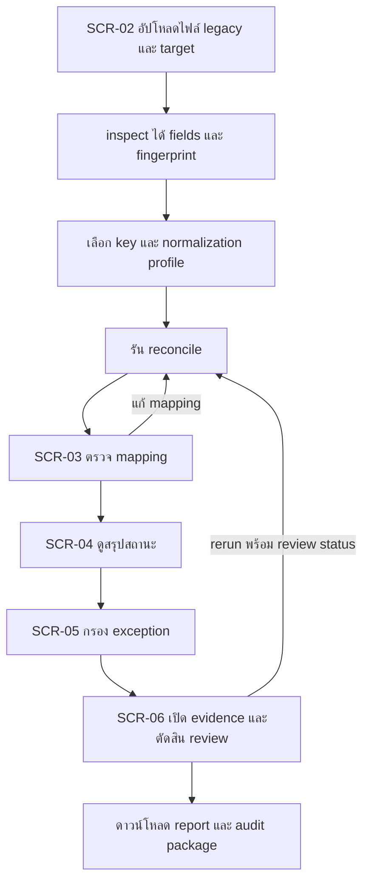
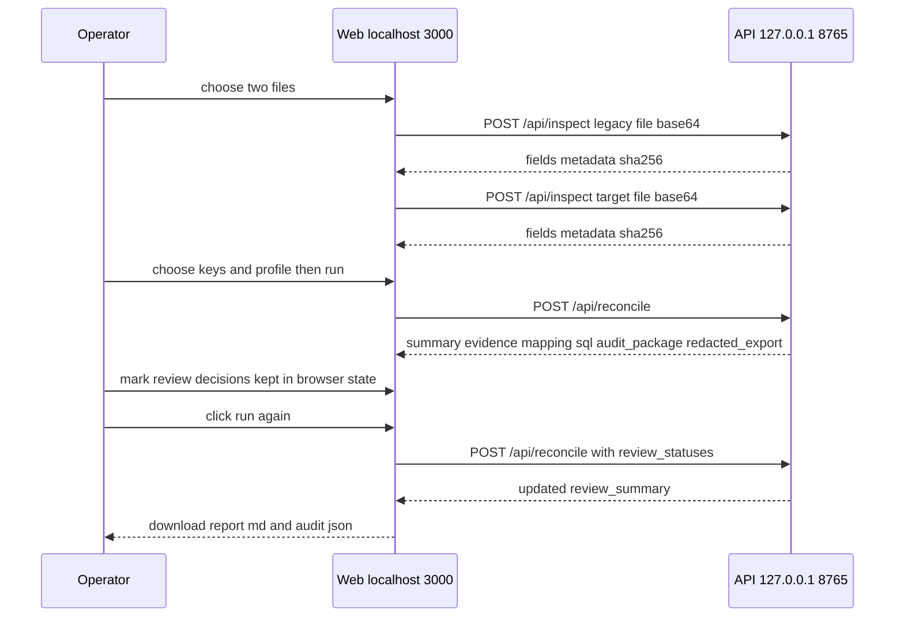
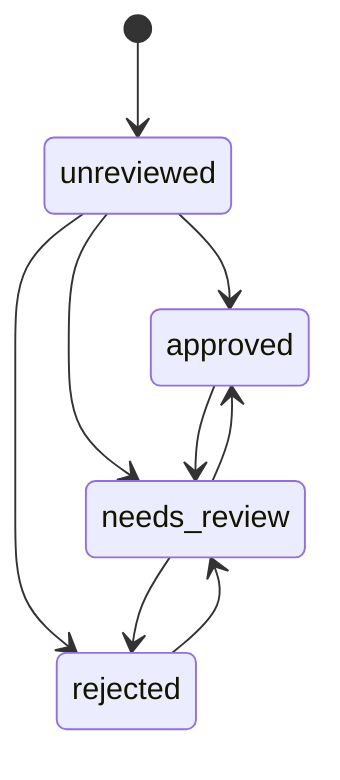

# Migration Validation Workbench — User Flow และ Screen Inventory

## 1. รายการหน้าจอ

เว็บเป็นหน้าเดียว (`apps/web/app/page.tsx`, 377 บรรทัด) แบ่งเป็น section ที่ปรากฏตามลำดับงาน

| ID | Section | ป้ายในหน้า | บทบาท | สถานะ |
|---|---|---|---|---|
| SCR-01 | Hero | "จาก “น่าจะย้ายครบ” เป็นหลักฐานที่ตรวจซ้ำได้" | Operator | Built |
| SCR-02 | Setup | `01 / INPUTS` — "เลือกข้อมูลสองฝั่ง": upload legacy/target, `ใช้ข้อมูลตัวอย่าง`, เลือก key, normalization profile, ตั้งค่า fuzzy, ปุ่มรัน | Operator | Built |
| SCR-03 | Mapping | `02 / FIELD CONTRACT` — "ตรวจ mapping ก่อนเชื่อผล": ตาราง mapping ที่แนะนำพร้อม confidence และตัวเลือกแก้ไข | Operator | Built (แสดงหลังมีผล) |
| SCR-04 | Results summary | การ์ดสรุปจำนวนต่อสถานะและ match rate | Operator | Built |
| SCR-05 | Evidence | `03 / EVIDENCE` — "Exceptions ที่ต้องตัดสินใจ": filter สถานะ, ค้นหา key, ตาราง evidence, ปุ่มดาวน์โหลด report / audit package, คัดลอก SQL | Operator | Built |
| SCR-06 | Drill-down | แผงด้านข้าง: reason, `REVIEW DECISION` (Approve/Reject/Needs review), `FUZZY CANDIDATES · REVIEW ONLY`, `FIELD DIFFERENCES` | Operator | Built |
| SCR-07 | API docs | `http://127.0.0.1:8765/docs` (OpenAPI ของ FastAPI) | Developer | Built |

## 2. User flow หลัก

### 2.1 ตรวจ migration หนึ่งรอบ

### 2.2 ลำดับการเรียก API

### 2.3 สถานะ review ของ evidence

ค่าในโค้ดใช้ `needs-review` (มีขีด) — ในแผนภาพเขียน `needs_review` เพื่อให้ syntax ถูกต้อง การเปลี่ยนกลับไปมาเป็นอิสระในหน้าเว็บ

## 3. Design system/component

- ไม่มี component library; ใช้ CSS เดียว `apps/web/styles.css` กับ class เช่น `panel`, `section-kicker`, `status-badge status-<status>`, `review-badge`, `button ghost|dark`, `drilldown`, `empty-state`
- ภาษา UI ไทยเป็นหลัก ศัพท์เทคนิค (mapping, evidence, fuzzy) เป็นอังกฤษ
- Accessibility (pass 2026-09-30): label ให้ control mapping/filter/search, แถว evidence เลือกด้วย Enter/Space และมี `aria-current`
- ยังไม่มี UX test กับ operator จริง (MVW-123/124) **[ต้องยืนยัน]** ว่าลำดับ section ตรงกับวิธีทำงานของ operator

## การอนุมัติ

| บทบาท | สถานะ | วันที่ | ลงนาม |
|---|---|---|---|
| UX/UI (Book Dev) | รอพิจารณา | — | ________ |

## แหล่งข้อมูล

- `apps/web/app/page.tsx`, `apps/web/styles.css`
- `apps/api/src/migration_validation_api/server.py`
- `packages/reconciliation-core/src/reconciliation_core/reconcile.py` (`REVIEW_STATUS_LABELS`)
- `docs/UPGRADE-PLAN.md`
